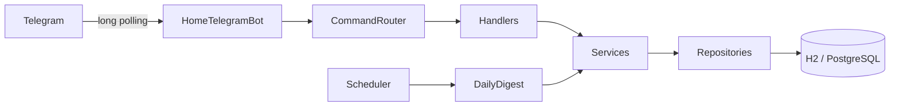

# Ortaq

Ortaq is a Telegram bot for roommates sharing a household. One Telegram group is one household. The bot records expenses and repayments, calculates balances and simplified transfers, rotates cooking duty, and keeps small shared lists. Its messages and command menu are in Kazakh.

## Commands

| Command | What it does |
| --- | --- |
| `/start` | Show a short introduction |
| `/komek` | Show command help |
| `/shygyn 630 су` | Add an expense; plain `630 су` also works in a group |
| `/shygyn 3000 пицца @user` | Split among mentioned members and the payer |
| `/balans` | Show every member's net balance |
| `/qaryz` | Show transfers needed to settle balances |
| `/tolem Асан 500` | Record a repayment; the name can be omitted with two members |
| `/oshiru` or `/oshiru 12` | Undo your last entry or your entry by ID |
| `/tarih` | Show the last 10 expenses and repayments |
| `/esep` or `/esep 9` | Show this month's or September's report |
| `/kezek` | Show today's cook and the next three days |
| `/otkizu` | Pass today's cooking turn to the next member |
| `/dayyn` | Announce that food is ready |
| `/tizim` or `/tizim сүт, нан` | Show or add shopping items |
| `/satyp 12` | Mark a shopping item as bought |
| `/jazba` or `/jazba text` | Show or add shared notes |
| `/jazba_oshiru 12` | Soft-delete a note |
| `/is text` | Log a completed chore |
| `/ister` | Show the last 10 chores |
| `/songy сүзгі` | Find when a chore was last done |
| `/merzim` | Show payment deadlines and days left |
| `/merzim_qosu 5 150000 Жалдау` | Add a monthly deadline; use `-` for no amount |
| `/merzim_oshiru 12` | Remove a deadline |
| `/kim` | Choose a random household member |
| `/tandau a, b, c` | Choose one of 2–10 options |
| `/tiyn` | Flip a coin |

`/start` and `/komek` work in private chats. Other commands require a group. Each roommate must send a message to register. Disable privacy mode in BotFather to enable plain expense messages.

## Architecture



Pure Java classes handle parsing, splitting, debt calculation, date policy, countdowns, and random choices. Spring services coordinate those rules with JPA repositories. The bot uses plain text responses.

## Stack

Java 21, Spring Boot 3.3.4, Spring Data JPA, TelegramBots 7.11.0 long polling, H2 for local development, PostgreSQL in production, Maven, JUnit 5, and AssertJ.

## Run locally on Windows

1. Install Java 21. Create a **development bot** in BotFather; use a different bot token for deployment.
2. Set variables in PowerShell:

   ```powershell
   $env:BOT_TOKEN = '<development bot token>'
   $env:BOT_USERNAME = '<development bot username>'
   ```

3. Run `./mvnw.cmd test` and then `./mvnw.cmd spring-boot:run`.
4. Add the bot to a group. Check `http://localhost:8080/health` for `OK`.

The default `dev` profile uses a file-based H2 database in `./data/homebot`. Tests use in-memory H2 and fake bot credentials. See [.env.example](.env.example) for the minimum variables.

| Variable | Required | Purpose |
| --- | --- | --- |
| `BOT_TOKEN` | Yes | Telegram bot token |
| `BOT_USERNAME` | Yes | Bot username without `@` |
| `SPRING_DATASOURCE_URL` | Production | PostgreSQL JDBC URL with `sslmode=require` |
| `SPRING_DATASOURCE_USERNAME` | Production | PostgreSQL user |
| `SPRING_DATASOURCE_PASSWORD` | Production | PostgreSQL password |
| `PORT` | No | HTTP port, default `8080` |
| `ALLOWED_CHAT_IDS` | No | Comma-separated chat ID allowlist |

## Balances and debts

Each expense adds its full amount to the payer's balance and subtracts each participant's share. Repayments use the same ledger with one recipient. The `DebtCalculator` repeatedly pairs the person who owes the most with the person owed the most, transfers the smaller of those amounts, and repeats until all balances reach zero. For example, if A is owed 900 ₸ while B owes 600 ₸ and C owes 300 ₸, it suggests B → A: 600 ₸ and C → A: 300 ₸. Ties use member ID for repeatable results.

Money uses `BigDecimal` to preserve tiyn. Deletions are soft so ledger rows remain auditable. Dates use `Asia/Almaty`; the daily digest stores its last sent date in the household row so a restart does not repeat the day's message.

## Deployment and limitations

See [the deployment guide](docs/DEPLOY.md) for Neon, Render, environment variables, and a health-check pinger. **Live deployment URL:** add after deploying (`https://<service>.onrender.com/health`).

This version runs one polling instance per token. It does not yet handle members leaving a group. JPA uses `ddl-auto=update` rather than versioned migrations. Free Render services can sleep, and external hosting limits may change. The backlog includes Flyway migrations, webhook mode, a Mini App dashboard, recurring expenses, CSV export, receipt OCR, language switching, rate limiting, and metrics.

Screenshots and GIFs: add files to [`docs/img/`](docs/img/).
